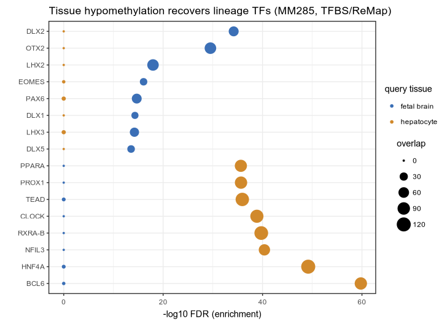
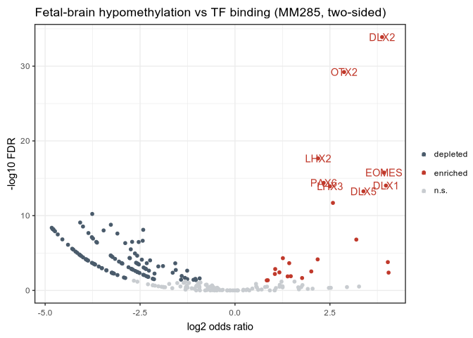
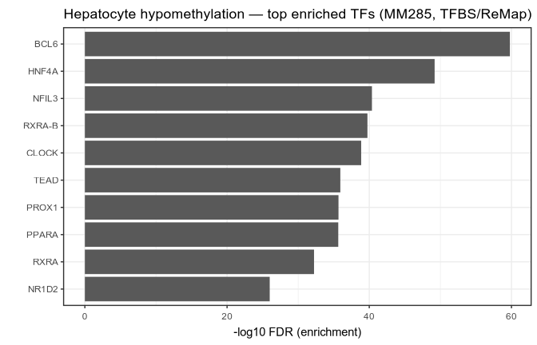
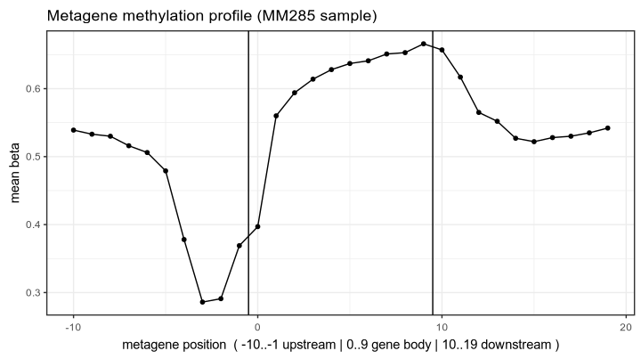
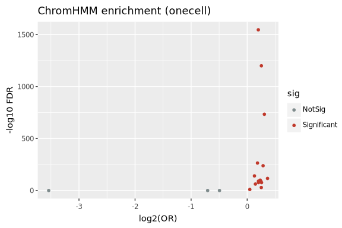
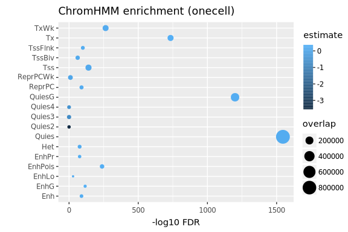
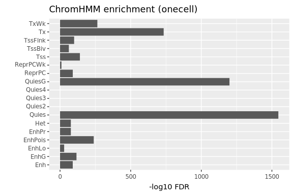
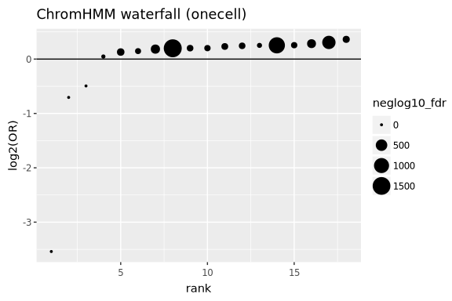

# kycg-examples

Runnable examples and gallery figures for [kycg](https://github.com/zhou-lab/kycg)
— the C command-line reimplementation of
[knowYourCG](https://github.com/zhou-lab/knowyourcg). Each example is a
self-contained script that turns the bundled example data into an enrichment
table and publication-ready figures, so the kycg docs are reproducible rather
than illustrative.

## Prerequisites

`kycg` and [cinderplot](https://github.com/zhou-lab/cinderplot) on your `PATH`:

```sh
conda install -c zhou-lab -c conda-forge kycg cinderplot
```

Or point the scripts at source builds with the `KYCG` / `CINDERPLOT` env vars.

## Layout

```
data/      example inputs (query .cg + knowledgebase .cm), self-contained
scripts/   one runnable script per worked example
results/   the kycg test output table (regenerated by the scripts)
figures/   rendered gallery figures (PDF for print, PNG for the web)
```

## Examples

### Recovering tissue identity from methylation (array)

`scripts/tissue_tfbs_enrichment.sh` asks whether kycg recovers known biology. A
tissue's **hypomethylated** CpGs mark the regulatory DNA it holds open, so its
Hypo probes from the MM285 tissue signature should enrich for that tissue's
lineage transcription factors. Tested against ReMap TF binding sites (638
factors) they do — cleanly, with no tuning:

```sh
bash scripts/tissue_tfbs_enrichment.sh   # fetches MM285:TFBSrm into the store
```



| fetal brain → neuronal TFs | hepatocyte → hepatic TFs |
|---|---|
|  |  |

Fetal-brain hypomethylation returns the neuronal program (`DLX1/2/5`, `OTX2`,
`PAX6`, `LHX2/3`, `EOMES`); hepatocyte returns the hepatic nuclear receptors
(`HNF4A`, `PPARA`, `RXRA`, `PROX1`) and the liver circadian core. The signal
tracks the cells present, not the organ name — `fetal_liver` returns `GATA1` /
`TAL1` (fetal liver is the site of fetal hematopoiesis).

The query masks (`data/<tissue>_hypo.cg`) are bundled, so the script needs no R.
`scripts/make_tissue_queries.R` documents how they were built from the signature
(the probe lists are also bundled as `data/<tissue>_hypo.txt`).

### Metagene methylation profile (array)

`scripts/metagene_profile.sh` reads out the classic gene methylation
architecture. A real MM285 sample's betas are averaged over the 30 metagene bins
of `MetagenePC` (`kycg test`'s `beta` column), giving the textbook profile:

```sh
bash scripts/metagene_profile.sh          # fetches MM285:MetagenePC
```



A hypomethylation dip at the promoter/TSS, gene-body hypermethylation rising
toward the 3′ end, and a return to the intergenic baseline downstream. The beta
query (`data/mm285_sample.cg`, `MM285.1.SigDF` packed as a fraction `.cg`) is
bundled; `scripts/make_tissue_queries.R` records the derivation.

### ChromHMM enrichment of a single-cell methylome (sequencing)

`scripts/chromhmm_enrichment.sh` tests one query cell (`data/onecell.cg`)
against the 18 ChromHMM chromatin states (`data/chromhmm.cm`), then renders the
four core KnowYourCG plots with cinderplot — no R involved.

```sh
bash scripts/chromhmm_enrichment.sh
```

| volcano | dot |
|---|---|
|  |  |
| **bar** | **waterfall** |
|  |  |

The enrichment table it produces is `results/res.tsv`; sort and threshold on
`log10_p` / `neglog10_fdr` (the `p_value` / `fdr` columns underflow to 0 for
strong hits by design).

## Data provenance

`data/chromhmm.cm` and `data/onecell.cg` are the example files shipped with the
knowYourCG Bioconductor package (`inst/extdata/`), reused here so the examples
run without installing R. Both index the same whole-genome CpG row space.

`data/<tissue>_hypo.{cg,txt}` are the fetal-brain / fetal-liver / hepatocyte
Hypo probe sets from the MM285 tissue signature (`sesameData`
`MM285.tissueSignature`), each packed into a binary mask over the MM285 probe
ordering. `scripts/make_tissue_queries.R` regenerates them (needs R + sesame and
the MM285 ordering); the `.cg` are bundled so the example itself needs neither.
The knowledgebase `TFBSrm` is fetched on demand into the shared YAME store.
